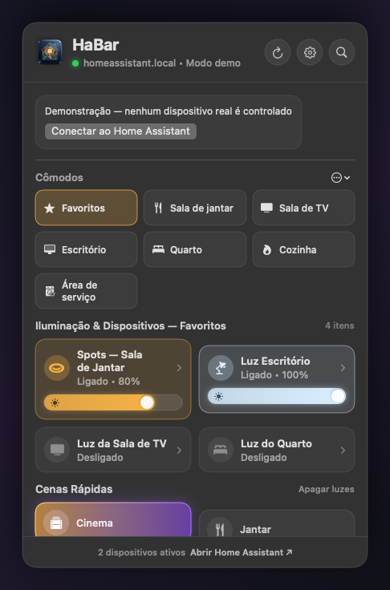
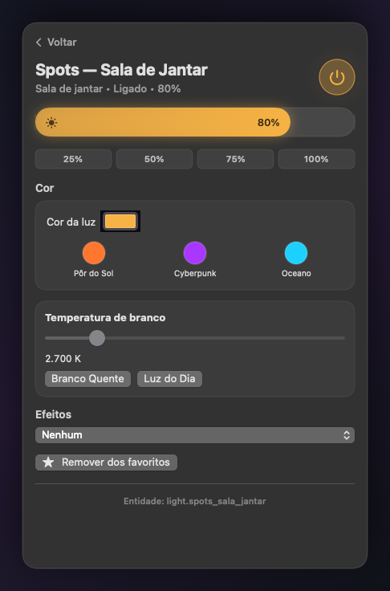

<p align="center"></p>

# HaBar

Native macOS menu bar controls for Home Assistant. Requires macOS 14 or newer.

| Dashboard | Light controls |
| --- | --- |
|  |  |

## Everyday controls

- A bounded, scrollable dashboard with favorites, a wrapping grid of room buttons, device search and quick scenes.
- Consistent interaction: the power button sends an action; the device name opens its details.
- Lights expose only supported brightness, RGB, white temperature and effect controls. White temperature respects the device's Kelvin limits.
- Climate controls preserve the reported temperature unit and increment. Switches, fans, locks, covers, scripts, media players and read-only sensors remain visible, including unavailable entities.
- Room assignments from Home Assistant take priority. Virtual climate entities and scripts without an area are matched to an existing room only when its full name or ID identifies one room unambiguously; other entities remain in “No room”.
- Search suggests explicit device, room and scene targets. For example, `living 50` lists matching rooms and dimmable lights; Enter only executes when there is a single result.
- Scenes indicate the last activation, not an inferred persistent on/off state.
- Separate Settings window, dark/light/system appearance, Portuguese and English, native color selection and keyboard controls.
- Global shortcut **⌥⌘H** registered with macOS; it does not monitor general keyboard input or require Accessibility permission.
- Choose a temperature sensor and a power sensor for the menu bar. Automatic selection applies only when exactly one suitable sensor exists. Fahrenheit/Kelvin and kW values are normalized for these metrics; unrelated power readings are never summed.

## Connection and command reliability

REST reads an initial snapshot and WebSocket subscribes to changes. “Connected” requires acknowledgement of the event subscription. The app reconciles another snapshot after subscribing, handles entity creation/removal, rejects older timestamped events, checks socket health and reconnects after network loss or wake.

Device actions are serialized. Pending brightness/color changes are merged; power-off supersedes delayed light changes. Commands are **not automatically replayed** after ambiguous failures. Cards distinguish sending, awaiting confirmation and failed/unconfirmed actions. Failed actions restore the last confirmed display state. Unknown or unavailable locks and contact sensors never claim a safe physical state.

The local history distinguishes requested actions, server acceptance and confirmed state. Server acceptance alone is not proof that a physical device moved. Scripts and scenes are recorded as accepted actions, since they do not provide a durable target state.

## Connecting

1. Open HaBar's Settings window.
2. Select a resolved Bonjour discovery result, or enter the server URL explicitly.
3. Create a long-lived access token in Home Assistant under **Profile → Security** and paste it into HaBar.
4. Test the exact endpoint, then choose **Save and connect**.

Use HTTPS for remote access. HTTP local connections are unencrypted and are identified in Settings. Credentials never follow HTTP redirects or implicit alternate endpoints. If your server redirects to HTTPS or another hostname, enter that final URL directly.

Tokens are stored exclusively in macOS Keychain, scoped to the normalized server URL. Legacy plaintext credentials are migrated and removed only after a successful secure write. `~/.config/habar/config.json` contains non-secret configuration; the `fallback_url` setting is no longer used to forward credentials to alternate hosts.

Without credentials, the app shows a clearly marked local demonstration. Authenticating physical-access actions uses macOS owner authentication (Touch ID or password). Failed authentication sends no opening command. This is a local safeguard, not a replacement for Home Assistant authorization or physical-device safety controls.

## Build and test

```sh
swift test
./scripts/build_app.sh
open HaBar.app
```

The build script produces a universal Apple Silicon/Intel bundle. `VERSION` is the version source. GitHub builds use ad-hoc macOS code signing plus a separate Ed25519 publisher signature for updates. Set `HABAR_SIGNING_IDENTITY` to a valid Developer ID Application identity to sign a distribution build; `HABAR_OUTPUT_DIR` can direct its output outside the repository.

The executable supports `--export-screenshots <directory>` for isolated demo rendering and `--verify-update` for a read-only download/verification of the latest published update (no Home Assistant connection or app replacement).

## Updates and releases

In-app updates do not require Apple Developer membership. Each release includes `HaBar.zip.sig`, an Ed25519 signature binding the ZIP's SHA-256, size, version and bundle identifier. The app verifies it against its embedded public key before extracting anything. A missing/invalid signature or checksum fails the update. The exact verified bundle tree is checked again before replacement.

The app also requires a valid macOS code signature (ad-hoc is accepted), supported architecture/OS and exact bundle version. If the running installation has an Apple Team ID, the replacement must additionally match that team and pass Gatekeeper assessment. Downloads go to disk and are size-limited; archive paths, links and expanded size are checked. Quarantine is not removed.

GitHub distribution is not Apple notarization. macOS may require the user's authorization on first launch. An intermediate developer build that previously disabled in-app updates needs one manual installation of 1.8.0; subsequent updates use the embedded publisher key.

The installer stages a verified sibling on the destination volume, keeps the previous bundle as a hidden `.HaBar-backup-*.app`, and restores it if replacement or launch fails. A successful `open` does not prove application health; the backup remains available for manual recovery. You may remove old backups after verifying the new version.

`./scripts/release.sh <version>` tests, updates `VERSION`, commits that change and prepares a tag. It does not push or publish. Once the commit and tag are pushed, **only CI** builds, signs and publishes the archive. It uploads a draft first, verifies the uploaded bytes/signature and GitHub digest, then publishes. The cask is generated from the exact published ZIP, never from an independent local build.

The release workflow requires the `HABAR_UPDATE_PRIVATE_KEY` GitHub Actions secret (base64 Ed25519 private key). Only the public key is committed in `UpdateTrust.swift`. Keep this secret protected: losing or replacing it without a coordinated transition requires users to reinstall manually. Never commit or print the private key. `scripts/sign_update.swift` signs and verifies releases and rejects a key that doesn't match the embedded public key.

The workflow publishes a matching `habar.rb` cask and updates `Casks/habar.rb` on `main`; branch protection must permit that bot update, or maintainers can copy the published recipe through their usual PR process.

## Structure

- `HomeAssistantClient`: endpoint validation, REST errors and acknowledged WebSocket lifecycle.
- `HomeAssistantStore`: presentation state and reconciliation with confirmed device state.
- `CommandCoordinator`: ordered writes, coalescing and cancellation of superseded commands.
- `HAEntityMapper`: domain capabilities, availability, typed metrics and timestamps.
- `KeychainHelper`: credential migration and non-secret configuration.
- `AppUpdater`: package verification, staging and recoverable replacement.
- `AuditLogger`: bounded local history with disk writes on a utility queue.

For testing boundaries and manual acceptance checks, see [validation](docs/validation.md).

## License

[MIT](LICENSE).
