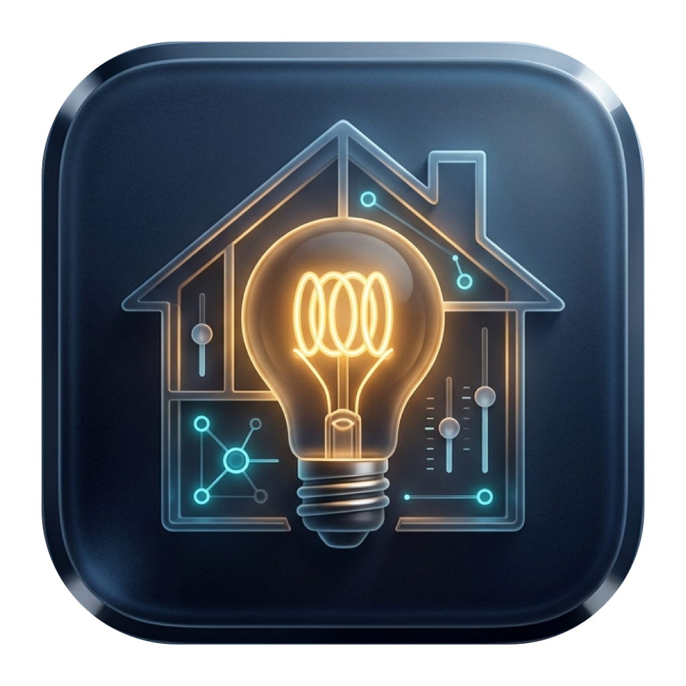
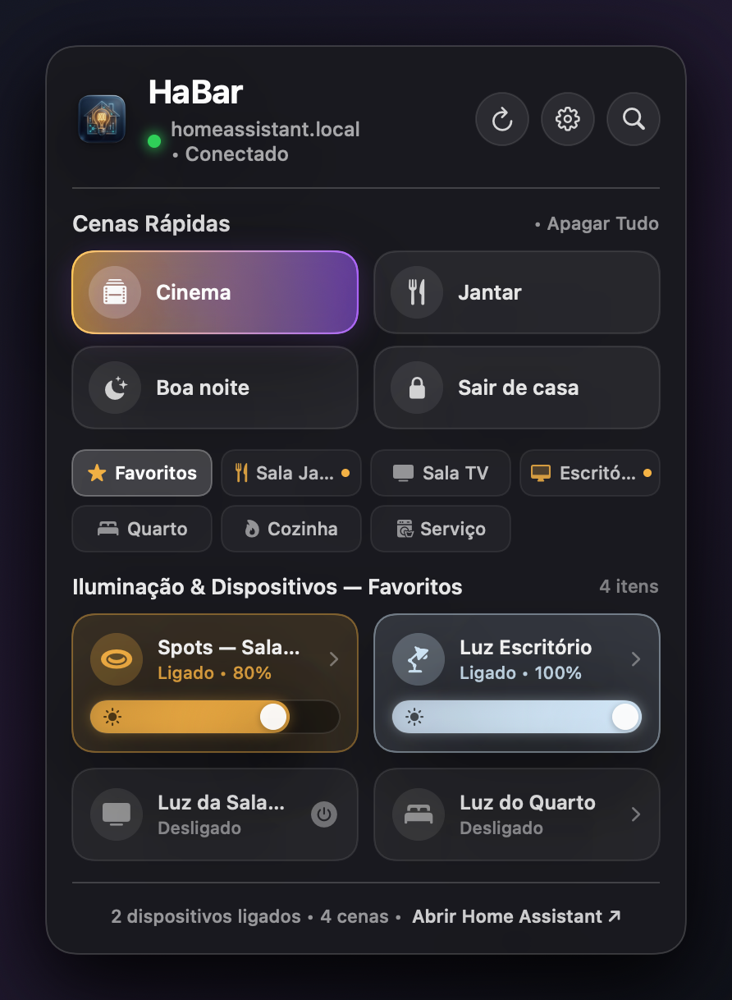
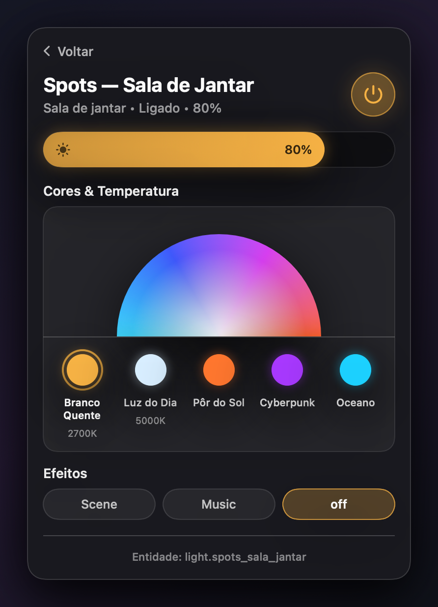

<p align="center">
  
</p>

<h1 align="center">HaBar</h1>

<p align="center">
  <strong>Native macOS Menu Bar Controller for Home Assistant</strong><br/>
  Control scenes, smart lights (RGB, Kelvin, Dimmer, Effects), and switches directly from the macOS Menu Bar.
</p>

---

## Screenshots

| Main Dashboard (Scenes, Rooms & Inline Dimmer) | Light Detail (RGB Dome, Kelvin & Effects) |
| :---: | :---: |
|  |  |

---

## Features

- **Native macOS Vibrancy UI (`NSVisualEffectView`)**: Dark frosted-glass popover matching macOS Sequoia / Control Center.
- **Dynamic Room & Area Discovery**: Automatically fetches your real rooms (`areas()`) and entity assignments from Home Assistant.
- **Zero-Scroll Room Pill Grid**: All rooms are visible at a glance with active-light indicator dots.
- **Quick Scenes (`scene.*`)**: Instant activation of Home Assistant scenes with expandable view.
- **Tactile Inline Brightness Sliders**: Drag directly on light cards to dim/brighten with 120ms network debounce for 120Hz UI smoothness.
- **Detailed Light Inspector**:
  - Interactive semi-circular **RGB & Color Temperature (Kelvin)** spectrum dome.
  - 1-click presets (*Warm White 2700K*, *Daylight 5000K*, *Sunset*, *Cyberpunk*, *Ocean*).
  - Dynamic **Effects** selector (`effect_list`).
- **Real-Time WebSocket Sync**: Subscribes to `state_changed` events via `/api/websocket` + REST fallback.

---

## Architecture (Clean Code & DRY)

```
Sources/HaBar/
├── HaBarApp.swift                   # NSStatusItem + NSPopover entry point
├── Theme/
│   └── AppTheme.swift               # Centralized design tokens & DRY view modifiers
├── Models/
│   └── HAEntity.swift               # Value-type models (RGBColor, HARoom, HADeviceItem) & HAEntityMapper
├── Services/
│   ├── HomeAssistantClient.swift    # Decoupled REST + WebSocket client
│   ├── HomeAssistantStore.swift     # @MainActor reactive store with O(1) entity lookup
│   └── KeychainHelper.swift         # Secure token storage (macOS Keychain + ~/.config/habar/config.json)
└── Views/
    ├── MainPopoverView.swift        # Main Control Center dashboard
    ├── LightDetailView.swift        # RGB / Kelvin / Effects inspector
    ├── SettingsView.swift           # Server URL & Long-Lived Access Token setup
    └── Components/
        ├── VisualEffectBlur.swift   # AppKit NSVisualEffectView bridge
        ├── TactileSlider.swift      # Smooth Control Center pill slider
        └── ColorSpectrumView.swift  # Interactive RGB dome & presets
```

---

## Building & Running

### Requirements
- macOS 14.0+ (Sonoma / Sequoia or newer)
- Swift 5.9+

### Build `.app` Bundle
```bash
./scripts/build_app.sh
open "HaBar.app"
```

---

## Connecting to Home Assistant

1. Click the house icon (`🏠`) in your macOS Menu Bar.
2. Click the gear icon (`⚙️`) in the top-right corner of the popover.
3. Enter your Home Assistant URL (e.g., `http://homeassistant.local:8123`) and paste your **Long-Lived Access Token** (created under *Profile → Security* in Home Assistant).
4. Click **Salvar & Sincronizar Cenas e Cômodos**.

---

## License

MIT License — see [LICENSE](LICENSE).
